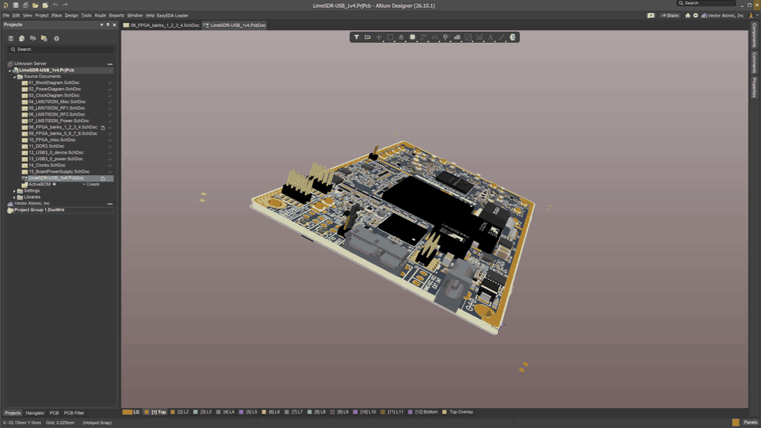
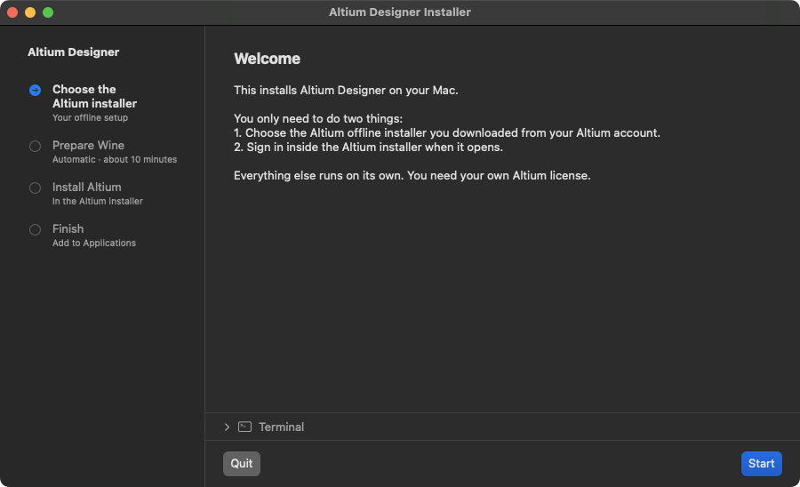
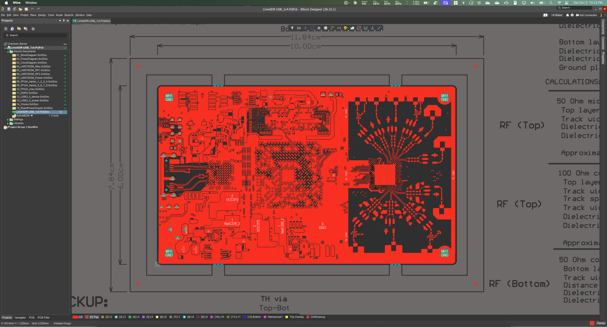
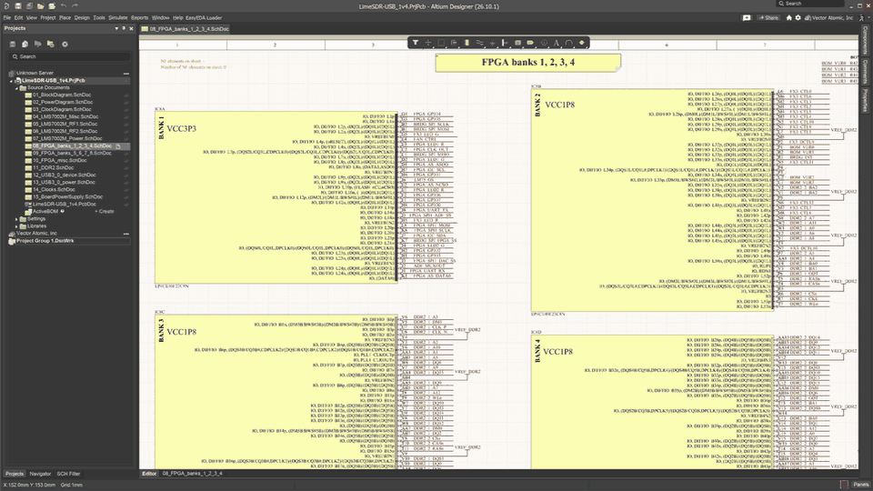
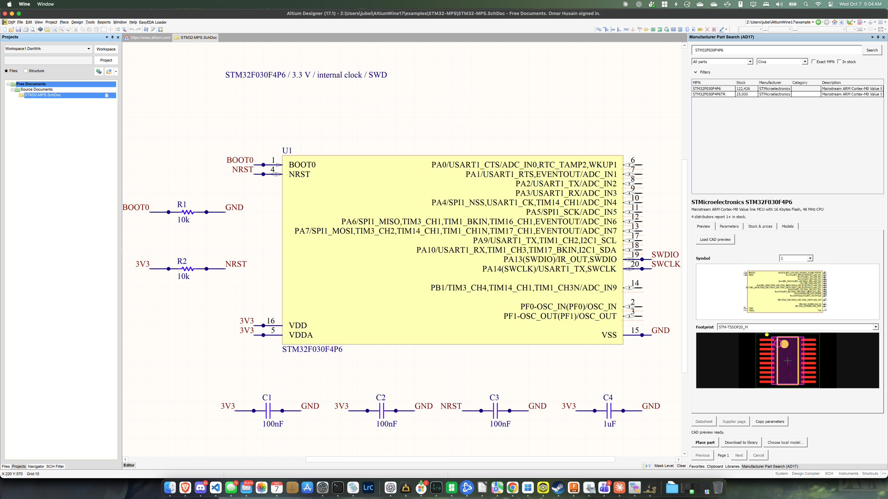

# Altium Designer on macOS with Wine

[](https://sonarcloud.io/summary/new_code?id=lazy-jubei_altium-wine)

Run Altium Designer on Apple Silicon Macs with patched Wine. Tested with Altium Designer 17.1 and 26.10.1 on an M4 Mac running macOS 15.7.9.

Altium 365 works, including project cloning.



*[LimeSDR-USB](docs/screenshots/README.md) by [Lime Microsystems / Myriad-RF](https://github.com/myriadrf/LimeSDR-USB).*

## Install

Get the Altium offline installer from your Altium account, then download and run the [kit installer](https://github.com/lazy-jubei/altium-wine/releases/tag/v1.2.0):

```bash
curl -fL https://github.com/lazy-jubei/altium-wine/releases/download/v1.2.0/install.sh -o install.sh
bash install.sh
```

To choose your offline setup folder or ZIP:

```bash
bash install.sh --altium-installer /path/to/offline-setup
```

A setup window opens and walks you through it. You only need to do two things: choose the Altium offline installer, then sign in inside the Altium installer when it opens. Everything else runs on its own. The window has a Terminal pane with the details. It's built on your Mac from `tools/AltiumInstaller.swift` with Apple's Command Line Tools, so there's no downloaded app to approve. Without the Command Line Tools, or with `--terminal`, the installer asks in Terminal instead.



The installer sets up Wine and fonts and creates `~/Applications/Altium Designer (Wine).app`. It uses prebuilt Wine modules, so Xcode isn't required. The fonts need `cabextract`, which comes from MacPorts; setup installs MacPorts from its notarized package if it isn't there (one administrator password). Rosetta 2 is required.

On a Retina display Altium draws at 2× for sharp text. On a standard (1×) display it draws at 1× and a Direct2D patch antialiases the schematic text instead; the display is checked each time Altium starts (`RETINA_MODE` in `config.sh` overrides it).

Altium's Windows drive lives in its own case-insensitive disk image, `~/AltiumWine/altium-wine.sparsebundle` (mounted at `~/AltiumWine/volume`), so it works the same on any Mac drive. The image only takes the space it uses, up to 200 GB. An install from before the image keeps its prefix in `~/AltiumWine/prefix`.

Optimizations include:

- Cached Direct2D geometry and ordered AD26 draw batching for faster schematics.
- Matched color spaces, parallel copies and native AD17 pan compositing.
- Queued Direct3D uploads, [AD17 PCB helpers and optional Metal grid caching](docs/technical-notes.md#altium-17).
- Fixes for hidden dialogs, floating panels, tooltip input and Vault freezes.
- macOS app-control support and WebView2 cleanup that waits for an idle editor.

For faster AD17 3D panning, disable **Use Ordered Blending in 3D** in **Preferences → PCB Editor → Display**. [Tuning details](docs/technical-notes.md).

Wine and Altium live in `~/AltiumWine`. Re-run `install.sh` to update.

[Setup and sign-in guide](docs/setup.md) · [Patch details and troubleshooting](docs/technical-notes.md)

## Screenshots

**PCB View**



**Schematic view**



**Altium 17**



## Build

Requires Rosetta 2, Xcode Command Line Tools and MacPorts (installed for you if missing). Allow about 3 GB of disk space and 15 minutes for the first build.

```bash
git clone https://github.com/lazy-jubei/altium-wine.git
cd altium-wine
bash install.sh --build-from-source --altium-installer /path/to/offline-setup
```

The build patches Wine 11.16 for rendering, Rosetta, dialogs, networking and AD17 startup. Output: `~/AltiumWine/wine-patched`.

To rebuild and export the modules with checksums:

```bash
bash build-patched-wine.sh --export ~/AltiumWine/build/modules-export
```
